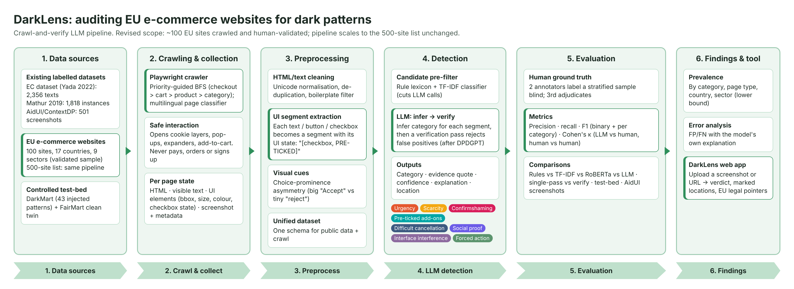

# DarkLens: auditing the web for dark patterns with LLMs

Final-year major project by Ashka Jain, Aarya Singh, Devanshi Shah and Dhruv Patel (Computer Engineering).

DarkLens crawls EU e-commerce sites, reaches the product, cart, checkout and cancellation pages where dark
patterns live, and classifies every visible element with an LLM that first *infers* and then *verifies* each
finding. The results are evaluated against human labels. A web app also lets anyone upload a screenshot or a
URL and see the dark patterns marked on it.



---

## 1. Setup (once, about 10 minutes)

```bash
python -m venv venv
venv\Scripts\activate            # Windows   (macOS/Linux: source venv/bin/activate)
pip install -r requirements.txt
python -m playwright install chromium
bash scripts/download_datasets.sh   # Windows without bash: run the three git clone lines in it by hand
python scripts/train_baselines.py   # trains offline models + creates data/splits (20 s)
python -m pytest -q                 # 28 tests should pass
```

**Tesseract OCR** (needed for screenshots):
- Windows: install from https://github.com/UB-Mannheim/tesseract/wiki and tick the German, French,
  Spanish, Italian and Dutch language packs. Then run
  `setx TESSERACT_CMD "C:\Program Files\Tesseract-OCR\tesseract.exe"` and open a new terminal.
- macOS: `brew install tesseract tesseract-lang`.

**An LLM key.** Pick one; any of them works.

| Provider | How to get it | Set it (Windows PowerShell) |
|---|---|---|
| Gemini (free tier, recommended) | https://aistudio.google.com/apikey | `$env:DARKLENS_PROVIDER="gemini"; $env:GEMINI_API_KEY="..."` |
| OpenAI | platform.openai.com | `$env:DARKLENS_PROVIDER="openai"; $env:OPENAI_API_KEY="..."` |
| Anthropic | console.anthropic.com | `$env:DARKLENS_PROVIDER="anthropic"; $env:ANTHROPIC_API_KEY="..."` |
| Local model (no key) | install Ollama, `ollama pull qwen2.5vl:7b` | `$env:DARKLENS_PROVIDER="ollama"; $env:OLLAMA_HOST="http://localhost:11434"` |

Optionally set `DARKLENS_MODEL` to choose a specific model. **Use the same model for every experiment** and
write its exact name in the paper. Without a key everything still runs, using the offline engine
(rules + TF-IDF + OCR).

## 2. Run the web app (for the demo)

```bash
uvicorn app.server:app --port 8000
```
Open http://localhost:8000. The app has four tabs:
- **Inspect**: drop or paste a screenshot, or enter a URL.
- **Annotate**: label ground truth.
- **Results**: every number from `results/`.
- **Taxonomy**: the categories DarkLens looks for.

API docs are at `/docs`.

## 3. Run the study: commands in order

| # | Step | Command | Time |
|---|---|---|---|
| 1 | Test-bed experiment (offline) | `python scripts/eval_testbed.py --engine offline` | 3 min |
| 2 | Test-bed experiment (LLM) | `python scripts/eval_testbed.py --engine llm` | 5 min |
| 3 | LLM on held-out text (main + ablation) | `python scripts/eval_llm_text.py --mode multistage` then `--mode single` | 5 min each |
| 4 | RoBERTa baseline | Google Colab GPU, see the top of `scripts/train_roberta.py` | 10 min |
| 5 | Screenshots, AidUI web (offline already done) | `python scripts/eval_screenshots.py --split web --engine llm --mode multistage` then `--mode single` | 20–40 min |
| 6 | EU crawl, pilot | `python -m darklens.crawler.run_sites --limit 5 --headed` (watch it work) | 15 min |
| 7 | EU crawl, full | `python -m darklens.crawler.run_sites --workers 3` (resumable; re-run if stopped) | 3–5 h |
| 8 | Detection over the crawl | `python -m darklens.pipeline --engine llm` | 1–2 h |
| 9 | Annotation sample | `python scripts/make_annotation_sample.py --states 150` | 1 min |
| 10 | Two people label it independently | Web app → Annotate tab (keys 1–8, 0, S) | 1–2 h each |
| 11 | Agreement, then adjudication | `python scripts/agreement.py`. The third person labels the items in `data/annotation/adjudication.csv` in the Annotate tab, then runs `python scripts/agreement.py --adjudicator <name>` | 30 min |
| 12 | Evaluation + prevalence | `python scripts/evaluate_crawl.py` | 1 min |
| 13 | Update the paper | `python scripts/make_paper_assets.py`, then recompile `paper/main.tex` | 1 min |

Every `[pending]` in the paper turns into a measured number at step 13. Never type numbers into the paper
by hand.

**Before the full crawl:** open `config/sites_eu.csv` and check that every site still loads. Replace dead
ones with another retailer from the same country and sector. To scale to 500 sites, add rows; nothing else
changes.

## 4. What is in the repository

```
darklens/
  taxonomy.py            8 categories, definitions, Mathur mapping, EU legal pointers
  crawler/               V1–V4: priority BFS, page classifier, safe interaction, evidence capture
  preprocessing/         cleaning, UI segments with state, choice-size asymmetry, dataset loaders, rule lexicon
  detection/             LLM client (Gemini/OpenAI/Claude/Ollama), prompts, infer→verify detector, OCR, baselines
  evaluation/            metrics (P/R/F1, Cohen/Fleiss kappa, bootstrap CI), annotation + agreement
  pipeline.py            crawl → segments → pre-filter → detector → predictions
app/                     FastAPI server + web interface (no build step)
testbed/                 DarkMart (43 injected patterns) and FairMart (clean twin) + ground truth
scripts/                 every experiment, one script each
config/sites_eu.csv      100 EU retailers, 17 countries, 9 sectors
paper/                   IEEE paper (main.tex, refs.bib, generated/ tables + figures)
results/                 JSON results (the single source of truth for every reported number)
legacy/                  the first single-page experiments (kept for the report's history section)
```

## 5. Results so far (measured, in `results/`)

| Experiment | Result |
|---|---|
| Text, 5-fold grouped CV, 2,356 items | Rules F1 0.709 (P 0.995, R 0.550); TF-IDF+LR F1 **0.960**, category macro-F1 0.769 |
| Test-bed, offline engine | **43/43** injected patterns found; 84.8% precision; 9 false alarms on the clean shop ("In stock", "Save", "Cancel membership") |
| AidUI web screenshots, offline (tuned on mobile split) | F1 0.673 (P 0.545, R 0.880) |
| LLM rows, RoBERTa, EU crawl | need an API key, a GPU or the live web. Run steps 2–13 above |

## 6. Team split for the remaining work

| Who | Owns | Steps |
|---|---|---|
| Ashka | LLM experiments, paper results and discussion | 2, 3, 5, 8, 12, 13 |
| Aarya | EU crawl: verify site list, pilot, full crawl, crawl QA | 6, 7 + `config/sites_eu.csv` |
| Devanshi | RoBERTa on Colab; annotator 1; report chapters on literature and design | 4, 10 |
| Dhruv | Annotator 2; demo script and slides; report chapters on testing and results | 10, demo |
| Adjudicator | whoever did not annotate a given item (rotate) | 11 |

## 7. Ethics

We crawl only public pages, respect `robots.txt`, wait between requests, and never pay, place orders, sign
up or submit personal data (see `darklens/crawler/safe_interaction.py`). The EU legal references in the app
are pointers for an auditor, not legal conclusions.
